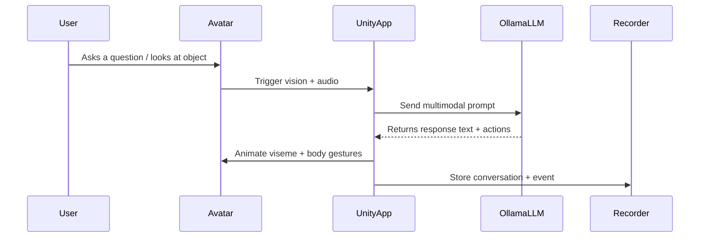
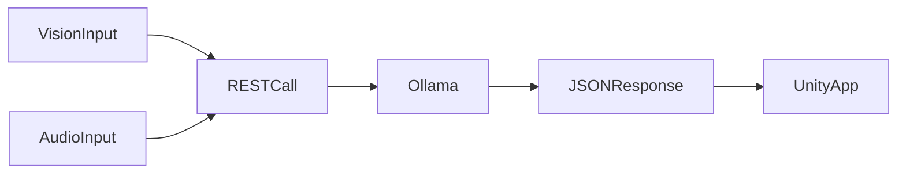

# Companion Intelligence for XREAL - Embodied AI Assistant & Life Logger

## 1. Project TODO List

### 🎯 Core Development Tasks

| Category | Task | Detailed Sub-Steps | Priority | Status |
|----------|------|-------------------|----------|--------|
| **Project Setup** | Initialize Unity XREAL Project | **1.1** Create new Unity 2022.3 LTS project with 3D template<br>**1.2** Import XREAL Unity SDK package<br>**1.3** Configure XR settings for XREAL devices<br>**1.4** Set up Git repository with .gitignore for Unity<br>**1.5** Configure project settings for Android build target<br>**1.6** Set up folder structure: Scripts/, Prefabs/, Materials/, Resources/<br>**1.7** Configure build settings for Beam Pro and Ultra devices<br>**1.8** Test basic XREAL scene rendering | High | ⭕ |
| **XREAL SDK Integration** | XREAL Development Environment | **2.1** Download and install XREAL Unity SDK from developer portal<br>**2.2** Create XREAL developer account and register devices<br>**2.3** Configure Android SDK path in Unity preferences<br>**2.4** Set up XREAL build profiles for Beam Pro and Ultra<br>**2.5** Import XREAL sample scenes and test compilation<br>**2.6** Configure device-specific settings (display resolution, refresh rate)<br>**2.7** Test basic tracking and rendering on target devices<br>**2.8** Set up debugging and logging for XREAL development | High | ⭕ |
| **Input Subsystem** | XREAL Audio Manager | **3.1** Research XREAL microphone API specifications<br>**3.2** Create AudioManager MonoBehaviour script<br>**3.3** Implement microphone permission handling for Android<br>**3.4** Configure audio capture with optimal settings (sample rate, channels)<br>**3.5** Implement audio buffer management for continuous recording<br>**3.6** Add noise reduction and audio preprocessing<br>**3.7** Create audio visualization for debugging<br>**3.8** Test audio quality on both Beam Pro and Ultra<br>**3.9** Implement background audio capture for life-logging<br>**3.10** Add privacy controls for audio recording | High | ⭕ |
| **Input Subsystem** | XREAL Camera Manager | **4.1** Study XREAL camera API documentation<br>**4.2** Create CameraManager script for RGB and passthrough cameras<br>**4.3** Implement camera permission handling<br>**4.4** Configure camera resolution and frame rate optimization<br>**4.5** Implement frame capture and buffering system<br>**4.6** Add image preprocessing (resizing, format conversion)<br>**4.7** Create camera preview UI for debugging<br>**4.8** Implement continuous background image capture<br>**4.9** Add privacy indicators for camera usage<br>**4.10** Test camera performance on both device types | High | ⭕ |
| **AI Analysis Engine** | Object Detection System | **5.1** Design object detection pipeline architecture<br>**5.2** Create ObjectDetectionManager script<br>**5.3** Implement continuous frame analysis queue<br>**5.4** Add object classification and confidence scoring<br>**5.5** Create object persistence and tracking across frames<br>**5.6** Implement object database for known items<br>**5.7** Add semantic labeling for detected objects<br>**5.8** Create object interaction history tracking<br>**5.9** Test object detection accuracy in various environments<br>**5.10** Optimize detection performance for XREAL devices | High | ⭕ |
| **AI Analysis Engine** | People Recognition System | **6.1** Design face detection and recognition pipeline<br>**6.2** Create PersonDetectionManager script<br>**6.3** Implement privacy-preserving person identification<br>**6.4** Add person tracking across conversation sessions<br>**6.5** Create person profile and interaction history<br>**6.6** Implement conversation participant identification<br>**6.7** Add social context analysis (relationships, frequency)<br>**6.8** Create person-specific memory storage<br>**6.9** Test recognition accuracy and privacy compliance<br>**6.10** Implement consent management for person data | Medium | ⭕ |
| **AI Analysis Engine** | Place & Environment Analysis | **7.1** Create EnvironmentAnalysisManager script<br>**7.2** Implement location detection and labeling<br>**7.3** Add scene understanding and context recognition<br>**7.4** Create place-based memory associations<br>**7.5** Implement environment change detection<br>**7.6** Add activity recognition based on environment<br>**7.7** Create location history and patterns<br>**7.8** Implement place-specific AI behavior adaptation<br>**7.9** Test environment recognition in various settings<br>**7.10** Add GPS integration for outdoor location context | Medium | ⭕ |
| **AI Analysis Engine** | Event Detection & Logging | **8.1** Design event detection framework<br>**8.2** Create EventDetectionManager script<br>**8.3** Implement activity recognition algorithms<br>**8.4** Add event classification (meetings, meals, activities)<br>**8.5** Create event timeline and duration tracking<br>**8.6** Implement event significance scoring<br>**8.7** Add automatic event summarization<br>**8.8** Create event search and retrieval system<br>**8.9** Test event detection across daily activities<br>**8.10** Implement event-triggered AI proactive suggestions | Medium | ⭕ |
| **Input Subsystem** | XREAL Interaction Manager | **9.1** Implement XREAL controller input handling<br>**9.2** Configure touch input for Beam Pro touchscreen<br>**9.3** Add gesture recognition system<br>**9.4** Implement head tracking and gaze-based interaction<br>**9.5** Create adaptive UI for different input methods<br>**9.6** Add haptic feedback integration<br>**9.7** Implement voice command shortcuts<br>**9.8** Test interaction responsiveness and accuracy<br>**9.9** Add accessibility features for diverse users<br>**9.10** Create interaction tutorial system | Medium | ⭕ |
| **Local Processing** | Speech-to-Text Integration | **10.1** Download and integrate whisper.unity package<br>**10.2** Configure Whisper models for XREAL Android architecture<br>**10.3** Implement real-time audio streaming to STT<br>**10.4** Add language detection and multi-language support<br>**10.5** Optimize STT performance for mobile processors<br>**10.6** Implement continuous speech recognition<br>**10.7** Add speaker diarization for multi-person conversations<br>**10.8** Create STT accuracy monitoring and feedback<br>**10.9** Test STT performance in noisy environments<br>**10.10** Implement offline STT capabilities | High | ⭕ |
| **Local Processing** | Text-to-Speech Integration | **11.1** Download and integrate piper.unity package<br>**11.2** Configure Piper voice models for natural speech<br>**11.3** Implement TTS audio output optimization<br>**11.4** Add voice customization options<br>**11.5** Generate visemes and phonemes for lip sync<br>**11.6** Implement emotion and tone modulation<br>**11.7** Add SSML support for advanced speech control<br>**11.8** Optimize TTS latency for real-time conversation<br>**11.9** Test TTS quality on XREAL audio hardware<br>**11.10** Implement background TTS processing | High | ⭕ |
| **Communication Layer** | Ollama Connector | **12.1** Create OllamaClient script with HTTP communication<br>**12.2** Implement JSON payload formatting for multi-modal requests<br>**12.3** Add Base64 image encoding for visual queries<br>**12.4** Implement conversation history management<br>**12.5** Add retry logic and error handling<br>**12.6** Create connection pooling for performance<br>**12.7** Implement request queuing and prioritization<br>**12.8** Add response streaming for real-time updates<br>**12.9** Test communication reliability and performance<br>**12.10** Implement offline mode and data queuing | High | ⭕ |
| **Communication Layer** | WiFi Network Discovery | **13.1** Implement network scanning and server discovery<br>**13.2** Create manual server configuration UI<br>**13.3** Add connection status monitoring and indicators<br>**13.4** Implement automatic reconnection logic<br>**13.5** Add network quality assessment and adaptation<br>**13.6** Create server health monitoring<br>**13.7** Implement failover to backup servers<br>**13.8** Add network security validation<br>**13.9** Test network switching and roaming<br>**13.10** Create network troubleshooting tools | Medium | ⭕ |
| **Avatar System** | Ready Player Me Integration | **14.1** Install and configure RPM Unity SDK<br>**14.2** Create AvatarManager script for avatar loading<br>**14.3** Implement avatar customization interface<br>**14.4** Add avatar caching and optimization for XREAL<br>**14.5** Configure avatar rendering for XREAL displays<br>**14.6** Implement avatar quality settings and LOD<br>**14.7** Add avatar emotion and expression system<br>**14.8** Create avatar personality and behavior traits<br>**14.9** Test avatar performance on both devices<br>**14.10** Implement avatar backup and restore | Medium | ⭕ |
| **Avatar System** | Lip Sync Implementation | **15.1** Install and configure SALSA LipSync Suite<br>**15.2** Connect TTS audio output to lip sync system<br>**15.3** Calibrate mouth movements for XREAL display<br>**15.4** Add phoneme-based lip sync accuracy<br>**15.5** Implement real-time lip sync processing<br>**15.6** Add facial expression integration<br>**15.7** Create lip sync quality monitoring<br>**15.8** Test lip sync across different avatar models<br>**15.9** Optimize lip sync performance<br>**15.10** Add lip sync debugging tools | Medium | ⭕ |
| **Avatar System** | Animation Controller | **16.1** Create avatar animation state machine<br>**16.2** Implement idle animation variations<br>**16.3** Add gesture recognition and playback system<br>**16.4** Implement look-at behavior with XREAL head tracking<br>**16.5** Create procedural animations for natural movement<br>**16.6** Add emotion-based animation triggers<br>**16.7** Implement conversation-aware body language<br>**16.8** Create animation blending and transitions<br>**16.9** Test animation responsiveness and naturalness<br>**16.10** Add animation customization options | Medium | ⭕ |
| **Server Setup** | Ollama Server Configuration | **17.1** Install Ollama on local network server (PC/Mac/Linux)<br>**17.2** Download and configure Llama 3.2 Vision model<br>**17.3** Set up additional multi-modal models (Llava, etc.)<br>**17.4** Configure API endpoints and port settings<br>**17.5** Implement model switching and optimization<br>**17.6** Add GPU acceleration configuration<br>**17.7** Create server monitoring and health checks<br>**17.8** Implement request logging and analytics<br>**17.9** Test server performance with XREAL clients<br>**17.10** Set up automated backup and recovery | High | ⭕ |
| **Memory System** | Conversation Persistence | **18.1** Design conversation data schema and format<br>**18.2** Create ConversationManager script<br>**18.3** Implement conversation history storage<br>**18.4** Add conversation search and retrieval<br>**18.5** Create conversation summarization<br>**18.6** Implement conversation context window management<br>**18.7** Add conversation export and import<br>**18.8** Create conversation privacy controls<br>**18.9** Test conversation recall accuracy<br>**18.10** Implement conversation analytics and insights | Medium | ⭕ |
| **Memory System** | Life Logging Database | **19.1** Set up local vector database (ChromaDB/SQLite)<br>**19.2** Design life logging data schemas<br>**19.3** Create LifeLogManager script<br>**19.4** Implement memory extraction pipeline<br>**19.5** Add semantic search and retrieval system<br>**19.6** Create memory categorization and tagging<br>**19.7** Implement privacy-preserving storage encryption<br>**19.8** Add memory visualization and browsing<br>**19.9** Create memory export and sharing features<br>**19.10** Test memory system performance and accuracy | High | ⭕ |
| **Continuous AI Analysis** | Real-time Processing Pipeline | **20.1** Create ContinuousAnalysisManager script<br>**20.2** Implement frame-by-frame image analysis queue<br>**20.3** Add audio stream analysis for ambient sounds<br>**20.4** Create multi-modal data fusion system<br>**20.5** Implement context switching and attention management<br>**20.6** Add proactive suggestion and notification system<br>**20.7** Create analysis result caching and optimization<br>**20.8** Implement analysis scheduling based on device state<br>**20.9** Test continuous analysis impact on battery life<br>**20.10** Add user controls for analysis intensity | High | ⭕ |

### 🥽 XREAL Device-Specific Implementation

| Device | Task | Subtasks | Priority | Status |
|--------|------|----------|----------|--------|
| **XREAL Beam Pro** | Beam Pro Integration | Configure Unity for Beam Pro Android environment; Implement touchscreen UI controls; Optimize for Beam Pro's processing capabilities; Test camera and audio integration | High | ⭕ |
| **XREAL Ultra** | Ultra Integration | Configure Unity for XREAL Ultra; Implement advanced tracking features; Optimize for Ultra's enhanced capabilities; Test passthrough and spatial awareness | High | ⭕ |
| **Both Devices** | Cross-Device Compatibility | Implement device detection and configuration; Create adaptive UI for different form factors; Test feature parity between devices; Handle device-specific limitations | Medium | ⭕ |

### 🧪 Testing & Optimization

| Category | Task | Subtasks | Priority | Status |
|----------|------|----------|----------|--------|
| **Performance** | XREAL Optimization Pass | Profile Unity performance on XREAL devices; Optimize network communication for mobile processors; Test battery life impact; Memory usage optimization for Android | Medium | ⭕ |
| **User Experience** | XREAL UX Testing | Test conversation flow on XREAL displays; Validate multi-modal interactions; Test avatar presence and engagement; Collect user feedback from XREAL users | Medium | ⭕ |
| **Privacy & Security** | Security Audit | Validate local-only data processing; Test network security on XREAL devices; Implement data encryption; Create privacy documentation | High | ⭕ |

### 📚 Documentation & Deployment

| Category | Task | Subtasks | Priority | Status |
|----------|------|----------|----------|--------|
| **Documentation** | XREAL Technical Documentation | API documentation for XREAL SDK integration; Setup and installation guide for XREAL development; Troubleshooting guide for XREAL-specific issues; Architecture deep-dive | Low | ⭕ |
| **Deployment** | XREAL Build & Distribution | Configure build pipelines for XREAL devices; Create XREAL app packages; Set up XREAL testing environments; Prepare release artifacts for XREAL Store | Low | ⭕ |

**Legend:** ⭕ Not Started | 🟡 In Progress | ✅ Complete | ❌ Blocked

---

This document outlines the technical architecture for creating a persistent, embodied AI agent designed to function as a personal assistant and life-logging tool specifically for XREAL devices. The agent will manifest as a 3D avatar within the user's mixed reality environment using XREAL Beam Pro and XREAL Ultra headsets, capable of continuous perception, contextual conversation, and interaction.

The core objective is to build a system that transcends simple command-response interactions. This agent will maintain a memory of past conversations and observations, enabling it to act as an intelligent companion that understands the user's personal context. This "life-logging" capability positions the agent to not only answer questions but also to recall information, summarize events, and assist with tasks based on a persistent understanding of the user's world.

The architecture is designed specifically for XREAL devices (Beam Pro and Ultra) using Unity and the XREAL Unity SDK. All cognitive and perceptual processing will be handled by a local, on-network Ollama server. This client-server model ensures user privacy by keeping all data within the local network while leveraging the full power of large, multi-modal language models for sophisticated reasoning and visual understanding.

## 2. XREAL Device Support & User Experience

This project focuses exclusively on XREAL devices to provide an optimized, cohesive experience tailored to XREAL's unique capabilities and form factors.

### 2.1. XREAL Beam Pro Integration

The XREAL Beam Pro serves as the primary development target, offering:
- **Android-based Development Environment**: Leveraging Unity's Android build pipeline with XREAL-specific optimizations
- **Touchscreen Interface**: Native touch controls for avatar interaction and settings management
- **Portable Form Factor**: Optimized for on-the-go AI assistance and life logging
- **Camera Integration**: RGB camera access for environmental awareness and visual queries

### 2.2. XREAL Ultra Advanced Features

The XREAL Ultra provides enhanced capabilities for immersive AI interactions:
- **Advanced Tracking**: Superior spatial awareness and head tracking for more natural avatar positioning
- **Enhanced Display**: Higher resolution and field of view for better avatar rendering
- **Passthrough Technology**: Real-time environmental integration for seamless AR experiences
- **Performance Optimization**: Dedicated processing power for smoother AI interactions

### 2.3. Unified XREAL Experience

Both devices share core functionality while adapting to their specific capabilities:
- **Consistent Avatar Behavior**: Same AI personality and conversation continuity across devices
- **Adaptive UI**: Interface automatically adjusts to device capabilities and form factor
- **Cross-Device Memory**: Conversation history and life logs persist when switching between devices
- **Performance Scaling**: Automatic optimization based on device capabilities

## 3. Core Architectural Principles

* **Local-First Privacy**: All data, including audio recordings, visual captures, and conversation logs, remains within the user's local network. The Unity client communicates directly with a local Ollama server, eliminating reliance on cloud services for core AI processing and ensuring maximum user privacy.
* **Centralized Cognition**: A single, powerful multi-modal Large Language Model (LLM) running on the Ollama server acts as the agent's brain. This simplifies the XREAL client application, which offloads complex reasoning, visual analysis, and memory management to the server.
* **XREAL-Optimized Performance**: The Unity client is specifically optimized for XREAL's Android-based architecture, ensuring smooth performance and efficient battery usage on both Beam Pro and Ultra devices.
* **Adaptive Interface Design**: The client automatically detects the XREAL device type and adapts the user interface, interaction methods, and performance settings accordingly.

## 4. System Architecture Overview

The system is divided into two primary components: the **Unity XREAL Client**, which runs on XREAL devices, and the **Local Network Server**, which runs Ollama and the multi-modal LLM.

### 4.1. High-Level Architecture Diagram

```mermaid
graph TD
    subgraph Unity XREAL Client (Beam Pro / Ultra)
        A[User] -- Speaks & Looks --> B(XREAL Input Subsystem);
        B -- Audio Stream --> C{Speech-to-Text (Local Whisper)};
        B -- Image Stream --> D{XREAL Camera Manager};
        C -- Transcribed Text --> E[Communication Layer];
        D -- Encoded Image --> E;
        E -- JSON (Text + Image) --> F{Ollama REST API Request};
        G -- Parsed Text --> H{Text-to-Speech (Local Piper)};
        H -- Audio Stream & Visemes --> J[Avatar Expression];
        J -- Lip Sync & Animation --> K(Ready Player Me Avatar);
        K -- Speaks & Gestures --> A;
    end

    subgraph "Local Server (PC/Mac/Linux)"
        L(Ollama Server) -- Processes Request --> M((Multi-Modal LLM));
        M -- Generates Response --> L;
    end

    F -- HTTP POST via WiFi --> L;
    L -- HTTP Response --> G;

    style A fill:#f9f,stroke:#333,stroke-width:2px
    style K fill:#f9f,stroke:#333,stroke-width:2px
    style M fill:#9f9,stroke:#333,stroke-width:2px
```

### 4.2. Unity XREAL Client Components

The client application, built in Unity with the XREAL SDK, is responsible for all user-facing interactions and communication with the local server.

- **XREAL Input Subsystem:**
  - **XREAL Audio Manager:** Captures audio from XREAL device microphones, optimized for the specific audio hardware of Beam Pro and Ultra devices
  - **XREAL Camera Manager:** Accesses XREAL camera feeds (RGB camera on Beam Pro, passthrough cameras on Ultra) using XREAL SDK APIs for visual analysis
  - **XREAL Interaction Manager:** Handles device-specific input including touch controls on Beam Pro, controller input, and head tracking using XREAL SDK

- **Local Processing Subsystem:**
  - **Speech-to-Text (STT):** Utilizes `whisper.unity` optimized for Android/XREAL architecture to transcribe user speech on-device, providing fast response and reducing network traffic
  - **Text-to-Speech (TTS):** Employs `piper.unity` to synthesize LLM responses into audio, optimized for XREAL audio output systems

- **Communication Layer:**
  - **Ollama Connector:** A dedicated C# service optimized for XREAL's WiFi capabilities, formatting and sending requests to the Ollama server. Constructs JSON payloads containing user prompts, conversation history, and Base64-encoded images from XREAL cameras.

- **XREAL Embodiment Subsystem:**
  - **Avatar Manager:** Uses Ready Player Me SDK with XREAL display optimizations for 3D avatar rendering
  - **Lip Sync Manager:** Integrates SALSA LipSync Suite optimized for XREAL audio output and display capabilities
  - **XREAL Animation Controller:** Manages avatar animations with XREAL-specific optimizations for head tracking and spatial awareness

### 4.3. Local Network Server Components

The server runs on a computer within the same local WiFi network as the XREAL device, responsible for running the Ollama service.

- **Ollama Service:** The core application that hosts and serves large language models, exposing a REST API for interaction with XREAL clients
- **Multi-Modal LLM:** A powerful model capable of processing both text and images, such as Llama 3.2 Vision or Llava, handling all cognitive tasks for XREAL interactions
- **Persistent Memory (Optional Extension):** The Ollama server can be extended with a Python script to log conversations and extracted information into a local database (SQLite, ChromaDB) for life-logging capabilities

## 5. Core Interaction Flowchart

This flowchart details the process for a multi-modal query on XREAL devices, representing the most complex interaction loop.

```mermaid
flowchart TD
    A[User asks: "What is this object in front of me?"] --> B(XREAL Client: Mic records audio);
    B --> C{whisper.unity transcribes audio to text};
    C --> D[XREAL Client: Camera captures image frame];
    D --> E{Image encoded to Base64 string};
    subgraph "JSON Payload to Ollama"
        direction LR
        F1["prompt: 'What is this...'"]
        F2["images: ['...base64...']"]
        F3["history: [...]"]
    end
    E --> F1;
    E --> F2;
    C --> F3;
    F1 & F2 & F3 --> G((Ollama Server));
    G --> H{Multi-Modal LLM processes text and image};
    H --> I[LLM generates response text];
    I --> J[XREAL Client: Parse response text];
    J --> K{piper.unity generates speech audio};
    K --> L[Audio stream plays through XREAL speakers];
    K --> M{SALSA LipSync animates avatar mouth};
    L & M --> N(Avatar responds: "That appears to be a coffee mug.");
```

## 6. XREAL Development Tooling & SDK Reference

### 6.1. Core Development & XREAL Platform SDKs

| Tool / SDK | Purpose | Link |
| :--- | :--- | :--- |
| **Unity Engine** | Primary development environment for XREAL client application. | [unity.com](https://unity.com/) |
| **XREAL Unity SDK** | Essential SDK for XREAL device integration and hardware access. | [developer.xreal.com](https://developer.xreal.com/download) |
| **Android SDK & NDK** | Required for building to XREAL's Android-based platform. | [developer.android.com](https://developer.android.com/studio) |

### 6.2. AI, Avatar, and Animation Assets

| Asset / Tool | Purpose | Link |
| :--- | :--- | :--- |
| **Ollama** | Runs large language models on the local network server. | [ollama.com](https://ollama.com/) |
| **whisper.unity** | On-device Speech-to-Text (STT) optimized for Android/XREAL. | [GitHub](https://github.com/Macoron/whisper.unity) |
| **piper.unity** | On-device Text-to-Speech (TTS) using Piper and Unity Sentis. | [GitHub](https://github.com/Macoron/piper.unity) |
| **Ready Player Me SDK** | For creating and loading customizable avatars optimized for XREAL displays. | [GitHub](https://github.com/readyplayerme/rpm-unity-sdk-core) |
| **SALSA LipSync Suite** | Real-time, audio-based lip synchronization optimized for XREAL. | [Unity Asset Store](https://assetstore.unity.com/packages/tools/animation/salsa-lipsync-suite-148442) |
| **Unity Animation Rigging** | For procedural animations and XREAL head tracking integration. | [Unity Docs](https://docs.unity3d.com/Packages/com.unity.animation.rigging@1.1/manual/index.html) |

### 6.3. Key Reference Projects & XREAL Examples

| Project / Resource | Description |
| :--- | :--- |
| **XREAL Unity Samples** | Official XREAL Unity SDK examples and starter projects for device integration. |
| **unity-mcp-ollama** | Demonstrates connecting Unity to local Ollama instance, adaptable for XREAL architecture. |
| **XREAL Developer Documentation** | Comprehensive guides for XREAL device development, SDK usage, and best practices. |
| **UnityWebRequest for Android** | Unity networking examples specifically for Android platform, applicable to XREAL devices. |

## 7. XREAL-Specific Development Considerations

### 7.1. Device-Specific Optimizations

- **Performance Targeting**: Optimize for XREAL's Android-based architecture and mobile processors
- **Battery Efficiency**: Implement power management strategies for extended use during life-logging sessions
- **Thermal Management**: Monitor and adapt performance based on device temperature
- **Memory Management**: Efficient memory usage for avatar rendering and AI processing

### 7.2. XREAL SDK Integration Points

- **Device Detection**: Automatically detect Beam Pro vs Ultra and adapt features accordingly
- **Camera Access**: Use XREAL SDK APIs for optimal camera performance and quality
- **Display Optimization**: Leverage XREAL's display capabilities for avatar rendering
- **Audio Integration**: Utilize XREAL's spatial audio capabilities for immersive AI interactions

### 7.3. Development Workflow

- **XREAL Developer Account**: Required for accessing SDK and device testing
- **Unity Version**: Recommend Unity 2022.3 LTS for XREAL compatibility
- **Build Pipeline**: Configure for Android with XREAL-specific optimizations
- **Testing Strategy**: Test on both Beam Pro and Ultra devices throughout development

### 7.4. Future Expansion Possibilities

While this project focuses exclusively on XREAL devices, the architecture is designed to be modular. Future versions could potentially expand to support:

- Additional XREAL device models as they become available
- Enhanced XREAL-specific features like advanced spatial mapping
- Integration with XREAL's evolving SDK capabilities
- Performance optimizations for next-generation XREAL hardware

---

### 🚀 Implementation Strategy

#### Phase 1: Foundation (Weeks 1-4)
**Priority Focus:** Establish core development environment and basic functionality
- Complete Tasks 1-2: Project Setup & XREAL SDK Integration
- Complete Task 17: Ollama Server Configuration
- Begin Tasks 3-4: Audio & Camera Managers
- **Milestone:** Basic Unity project running on XREAL devices with Ollama connectivity

#### Phase 2: Core AI Pipeline (Weeks 5-8)
**Priority Focus:** Implement essential AI processing capabilities
- Complete Tasks 10-11: Speech-to-Text & Text-to-Speech Integration
- Complete Tasks 12-13: Communication Layer (Ollama Connector & WiFi Discovery)
- Begin Tasks 5-8: AI Analysis Engine (Object, People, Place, Event Detection)
- **Milestone:** Working voice conversation with multi-modal AI analysis

#### Phase 3: Avatar & Interaction (Weeks 9-12)
**Priority Focus:** Develop embodied avatar system and interactions
- Complete Tasks 14-16: Avatar System (Ready Player Me, Lip Sync, Animation)
- Complete Task 9: XREAL Interaction Manager
- Complete Tasks 18-19: Memory System (Conversation & Life Logging)
- **Milestone:** Fully functional AI companion with persistent memory

#### Phase 4: Continuous Analysis & Optimization (Weeks 13-16)
**Priority Focus:** Implement life-logging and optimize performance
- Complete Task 20: Continuous AI Analysis Pipeline
- Complete all Testing & Optimization tasks
- Complete Privacy & Security audit
- **Milestone:** Production-ready AI assistant with life-logging capabilities

### 🛠️ Development Dependencies & Tools

#### Essential Development Tools
| Tool | Version | Purpose | Installation |
|------|---------|---------|--------------|
| **Unity Editor** | 2022.3 LTS | Primary development environment | [Download from Unity Hub](https://unity.com/download) |
| **Android Studio** | Latest | Android SDK and build tools | [Download](https://developer.android.com/studio) |
| **Git** | Latest | Version control | `brew install git` (macOS) |
| **Visual Studio Code** | Latest | Code editing and debugging | [Download](https://code.visualstudio.com/) |

#### XREAL Development Requirements
| Component | Details | Notes |
|-----------|---------|-------|
| **XREAL Developer Account** | Required for SDK access | Register at [developer.xreal.com](https://developer.xreal.com) |
| **XREAL Unity SDK** | Latest version | Download from developer portal |
| **XREAL Device** | Beam Pro or Ultra | Required for testing and development |
| **USB Debugging** | Enable on device | For direct deployment and debugging |

#### AI & ML Dependencies
| Package | Purpose | Integration Method |
|---------|---------|-------------------|
| **whisper.unity** | Local speech-to-text | Unity Package Manager |
| **piper.unity** | Local text-to-speech | Unity Package Manager |
| **Unity Sentis** | ML inference runtime | Unity Package Manager |
| **Ready Player Me SDK** | Avatar system | Unity Package Manager |
| **SALSA LipSync Suite** | Lip synchronization | Unity Asset Store |

#### Server Requirements
| Component | Minimum Specs | Recommended Specs |
|-----------|---------------|-------------------|
| **CPU** | 4-core, 2.4GHz | 8-core, 3.0GHz+ |
| **RAM** | 8GB | 16GB+ |
| **GPU** | 4GB VRAM | 8GB+ VRAM (RTX 3070 or better) |
| **Storage** | 50GB available | 100GB+ SSD |
| **Network** | WiFi 5 (802.11ac) | WiFi 6 (802.11ax) |

### 🔒 Privacy & Security Considerations

#### Data Handling Principles
- **Local-First Architecture:** All personal data remains on local network
- **Encryption at Rest:** Life-logging database encrypted with user keys
- **Minimal Data Collection:** Only capture data necessary for functionality
- **User Consent:** Explicit permission for all data collection activities
- **Data Retention:** Configurable retention periods with automatic cleanup

#### Privacy Controls Implementation
1. **Audio Recording Consent:** Visual indicators and explicit permission requests
2. **Camera Usage Notifications:** Clear visual feedback when camera is active
3. **Person Recognition Opt-in:** Consent required before storing person data
4. **Memory Export Controls:** User-controlled data export and deletion
5. **Network Security:** TLS encryption for all client-server communication

### 📱 Device Support Matrix

| Feature | XREAL Beam Pro | XREAL Ultra | XREAL One Pro |
|---------|----------------|-------------|---------------|
| **Display Resolution** | 1920×1080 per eye | 3840×2160 per eye | 1920×1080 per eye |
| **Refresh Rate** | 120Hz | 144Hz | 120Hz |
| **Camera System** | RGB camera | Passthrough + RGB | RGB camera |
| **Audio** | Stereo speakers | Spatial audio | Stereo speakers |
| **Processing** | Snapdragon XR2 | Custom XREAL chip | Snapdragon XR2 |
| **Battery Life** | 4-6 hours | 6-8 hours | 4-6 hours |
| **Touch Input** | Touchscreen | Controllers | Touchscreen |
| **AI Analysis** | Full support | Enhanced performance | Full support |
| **Avatar Rendering** | Standard quality | High quality | Standard quality |

### 🔧 Development Setup Checklist

#### Pre-Development Setup
- [ ] Install Unity 2022.3 LTS
- [ ] Install Android Studio and configure SDK
- [ ] Create XREAL developer account
- [ ] Download XREAL Unity SDK
- [ ] Set up Git repository
- [ ] Configure VS Code with Unity extensions
- [ ] Install Ollama on development server
- [ ] Download Llama 3.2 Vision model

#### Project Configuration
- [ ] Create new Unity 3D project
- [ ] Import XREAL Unity SDK
- [ ] Configure Android build settings
- [ ] Set up XREAL-specific project settings
- [ ] Create folder structure for organized development
- [ ] Configure Git .gitignore for Unity
- [ ] Set up debugging and logging systems
- [ ] Test basic XREAL device connectivity

#### Development Environment Validation
- [ ] Verify Unity builds and deploys to XREAL device
- [ ] Test Ollama server connectivity from XREAL client
- [ ] Validate audio capture and playback
- [ ] Confirm camera access and image capture
- [ ] Test basic avatar rendering and animation
- [ ] Verify STT and TTS functionality
- [ ] Validate network communication reliability
- [ ] Confirm privacy and security measures

  

## 🧱 System Architecture

```mermaid
flowchart TD
    subgraph Client Devices
        Q3[Meta Quest 3]
        XREAL[XREAL SDK Device]
        Mobile[iOS / Android]
        WebClient[Web Client (3JS)]
    end

    subgraph XR Runtime
        UnityApp[Unity XR App]
        RPM[Ready Player Me Avatar + Visemes]
        Vision[Vision / Object Detection]
        Voice[Speech-to-Text / Text-to-Speech]
    end

    subgraph Backend
        Ollama[🔗 Ollama Local Multimodal LLM]
        CIAPI[Companion Intelligence REST API]
        Recorder[Life Log Recorder]
    end

    Client Devices --> UnityApp
    UnityApp --> RPM
    UnityApp --> Vision
    UnityApp --> Voice
    UnityApp --> CIAPI
    CIAPI --> Ollama
    CIAPI --> Recorder
```

---

## 🧠 Agent Behavior Loop



---

## ⚙️ Core Modules

| Module              | Description                                                        |
| ------------------- | ------------------------------------------------------------------ |
| 🧍 Avatar & Visemes | Ready Player Me with lip sync & gestures via SALSA/RT-Voice        |
| 🧠 LLM Backend      | Ollama server with local models (e.g., LLaVA, Llava-Next, Whisper) |
| 🧾 Logging Engine   | Stores user interactions, detected events, locations               |
| 📷 Vision           | Object detection via Quest/XREAL passthrough or mobile camera      |
| 🎤 Audio IO         | Whisper STT + Piper TTS with expressive speech plugins             |
| 📡 Interface        | REST API bridges Unity client ↔ Ollama / CI backend                |
| 🎮 Mixed Reality    | Unity-based spatial placement, tracking, AR alignment              |

---

## ✅ Development Milestones

### ✅ Prototype Setup

1. [ ] Get `QuestVisionKit/Samples/5` running (OpenAI → Ollama)

2. [ ] Replace API endpoint in `ImageOpenAIConnector.cs`
   🔗 [Line 170 on GitHub](https://github.com/xrdevrob/QuestCameraKit/blob/main/Unity-QuestVisionKit/Assets/Samples/5%20ImageLLM/Scripts/ImageOpenAIConnector.cs#L170)

3. [ ] Embed RPM avatar and position it spatially

4. [ ] Implement whisper+piper speech loop with visemes

---

## 🧰 Tool & Asset References

### 🎮 Unity XR + Avatar Tools

| Name                | Use                      | Link                                                                                                                               |
| ------------------- | ------------------------ | ---------------------------------------------------------------------------------------------------------------------------------- |
| QuestVisionKit      | Quest camera passthrough | [GitHub](https://github.com/xrdevrob/QuestCameraKit)                                                                               |
| Ready Player Me SDK | Avatars in Unity         | [Unity Asset Store](https://assetstore.unity.com/packages/tools/game-toolkits/ready-player-me-avatar-and-character-creator-259814) |
| SALSA LipSync Suite | Lip sync for avatars     | [Unity Store](https://assetstore.unity.com/packages/tools/animation/salsa-lipsync-suite-148442)                                    |
| RT-Voice PRO        | Viseme TTS               | [Unity Store](https://assetstore.unity.com/packages/tools/audio/rt-voice-pro-41068)                                                |
| SpeechBlend         | Viseme speech generation | [Unity Store](https://assetstore.unity.com/packages/tools/animation/speechblend-lipsync-149023)                                    |

---

### 🧠 AI Integrations

| Name                  | Use                          | Link                                                                                                                                                 |
| --------------------- | ---------------------------- | ---------------------------------------------------------------------------------------------------------------------------------------------------- |
| API for ChatGPT       | Simple Unity OpenAI plugin   | [Asset Store](https://assetstore.unity.com/packages/tools/ai-ml-integration/api-for-chatgpt-easy-ai-integration-248291)                              |
| Dialogue System Addon | OpenAI, ElevenLabs, Claude   | [Asset Store](https://assetstore.unity.com/packages/tools/ai-ml-integration/dialogue-system-for-unity-addon-for-openai-elevenlabs-other-gene-249287) |
| Unity MCP             | AI agent frameworks in Unity | [Unity MCP GitHub](https://github.com/justinpbarnett/unity-mcp)                                                                                      |

---

### 🔍 Vision & Spatial XR

| Tool                  | Use                   | Link                                                                                                                                      |
| --------------------- | --------------------- | ----------------------------------------------------------------------------------------------------------------------------------------- |
| UXR.QuestCamera       | Vision camera plugin  | [GitHub](https://github.com/Uralstech/UXR.QuestCamera/)                                                                                   |
| ObjectDetectionSentis | YOLO on Quest         | [Sample](https://github.com/oculus-samples/Unity-PassthroughCameraApiSamples/blob/main/Media/ObjectDetectionSentis.gif)                   |
| Marker Tracking       | ArUco, Image Tracking | [Quest Image Tracking](https://github.com/Aupuma/QuestImageTracking), [AR-Ultrasound](https://github.com/doughtmw/AR-Ultrasound-Training) |

---

## 🌐 Ollama Integration

Your Unity app will use a REST connector to forward vision & speech prompts to a **local Ollama server** running multimodal models like LLaVA or Llava-Next.



---

## 🌍 Multiplayer & Collaboration (Optional)

| Tool                          | Use               | Link                                                                                                      |
| ----------------------------- | ----------------- | --------------------------------------------------------------------------------------------------------- |
| Unity MR Multiplayer Template | Shared MR context | [Unity Forum](https://discussions.unity.com/t/new-mr-multiplayer-tabletop-template-now-available/1595933) |

---

## 🧪 Web Reference Implementation

| Feature             | Link                                                                                                |
| ------------------- | --------------------------------------------------------------------------------------------------- |
| 3JS version (web)   | [CI-Embodied-Companion-Web](https://github.com/companionintelligence/CI-Embodied-Companion-Web)     |
| Unity version (new) | [CI-Embodied-Companion-Unity](https://github.com/companionintelligence/CI-Embodied-Companion-Unity) |

---

## 🧑‍💻 ADB & Debugging Tips

```sh
adb connect 192.168.0.146:42663
adb -s TGLM4CG11864AA shell am start -n com.unity.template.urpblank
apkanalyzer manifest print ci-xr-test.apk | grep package
aapt dump badging ci-xr-test.apk | grep ^package:
```

---

Let me know if you'd like this as a downloadable `.md` file or want help auto-generating additional architecture diagrams or setup scripts.
