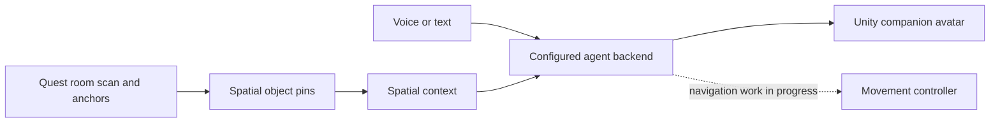
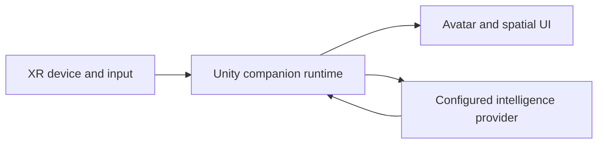

Private and Confidential

<h1 align="center">CI Spatial Companion</h1>

<strong>Spatial Companion Agent Unity - Xreal OpenXR</strong>

<a href="#getting-started">Get started</a> · <a href="https://docs.ci.computer/docs/reference/open-source-systems">Systems map</a> · <a href="README.md#architecture">Documentation</a>

  

An embodied mixed-reality companion for **Meta Quest 3** and **Pico** — a spatial agent that scans the room, drops world-anchored pins on detected objects, and answers questions about them through a **Ready Player Me avatar** that looks at you, speaks with viseme lip-sync, and (WIP) walks the space.

> **Ground-up rebuild (July 2026).** Unifies the scanning + embodied-avatar goals on a supported LTS, replacing the earlier XREAL prototype. Original design brief preserved at the bottom of this file.

## Status

- **Unity 6000.3.19f1 (6.3 LTS)** · URP · OpenXR-first (Meta Quest + PICO feature groups)
- All assemblies compile green; **10 EditMode tests passing**
- Phases 1–2 verified running in-Editor; Phases 3–6 implemented (on-device ML / device-only paths are scaffolded behind interfaces)

## Why the rebuild

The previous prototype targeted a since-broken toolchain. The full Meta XR SDK, UnityGLTF, and NaughtyAttributes do **not** compile on Unity 6.4/6.5 (a hard `CS0619` on `Object.GetInstanceID()`), and those are non-LTS releases. This rebuild targets **Unity 6.3 LTS** (supported to Dec 2027, validated by every vendor SDK in the stack) and uses the **OpenXR** path — `com.unity.xr.meta-openxr` for Quest and the PICO OpenXR SDK for Pico — so a single codebase produces one cross-vendor APK.

## Features

| Feature | What it provides |
|---|---|
| **Room understanding** | Combine room scan data and spatially anchored object pins. |
| **Perception seam** | Route image and conversation requests through configured services. |
| **Embodied companion** | Render an avatar with spatial context in Unity. |
| **Navigation status** | Walking and autonomous navigation remain work in progress. |

## How it fits together

Unity owns room capture, anchors and avatar rendering; perception and conversation use configured services. Navigation remains explicitly in progress.

## Architecture

OpenXR-first: the C# never branches per vendor — only the enabled OpenXR feature group changes. Every platform capability sits behind a `XRScan.Core` interface with a capability flag and graceful fallback (e.g. consumer Pico exposes no per-app RGB frames, so live-camera scanning auto-degrades to scene-semantics pins).

| Assembly | Responsibility |
|---|---|
| `XRScan.Core` | Zero-vendor-dependency interfaces + DTOs (the compile firewall) |
| `XRScan.Platform` | AR Foundation camera / scene / room-mesh providers; `PlatformCapabilities` |
| `XRScan.Vision` | CV server client + `RemoteCvDetector`; on-device `SentisYoloDetector` (scaffold) |
| `XRScan.Mapping` | `ViewportRaycaster`, `SpatialPinManager` (2D detection → world pins) |
| `XRScan.Avatar` | Avatar load, gaze, gesture, viseme lip-sync, NavMesh locomotion |
| `XRScan.Voice` | STT / TTS (cloud + on-device Sentis/Piper scaffolds) |
| `XRScan.Llm` | Pluggable LLM backends (Ollama / OpenAI / Claude / CI server) |
| `XRScan.Agent` | `ConversationOrchestrator` + `SceneKnowledgeBase` (grounds the LLM in scanned pins) |
| `XRScan.Export` | glTF export via glTFast + server sync |
| `XRScan.App` | `AppBootstrap` startup wiring + `ScanController` |
| `XRScan.Mocks` | Editor/test doubles so the whole app runs with no device/server |

### Pluggable intelligence (the "hybrid" seam)

Every stage is an interface — swap the implementation via config, no recompile:

- `IObjectDetector` → remote CV server **or** on-device Sentis (auto-selected by `DetectorFactory`)
- `ILlmBackend` → Ollama / OpenAI / Claude / Companion Intelligence server
- `ISpeechToText` / `ITextToSpeech` → cloud Whisper/TTS **or** on-device Sentis Whisper / Piper
- `ICameraProvider` → Quest passthrough (AR Foundation) with a Pico/desktop fallback

Endpoints and API keys are read from `ServerConfig` / `LlmConfig` / `VoiceConfig` ScriptableObjects via PlayerPrefs / environment variables — **never committed**.

## Getting started

1. Open with **Unity 6000.3.19f1** (with Android Build Support). Packages resolve automatically (RPM, uLipSync, glTFast, PICO OpenXR are pulled via git).
2. Open `Assets/XRScan/App/Scenes/XRScan_Main.unity` and press **Play** — it runs entirely on mocks (mock camera → detector → pin → avatar looks + speaks; push-to-talk voice Q&A). No device or server required.
3. To use real backends, set `useMocks = false` on `AppBootstrap` and fill in `ServerConfig` / `LlmConfig` / `VoiceConfig`.
4. Build for Quest 3 / Pico: Android, IL2CPP, ARM64, Vulkan, min SDK 32; enable the OpenXR loader + the relevant feature group under **Project Settings → XR Plug-in Management**.

## Avatars

RPM / Wolf3D GLB avatars live in `Assets/XRScan/Avatar/Models/` (glTFast imports `.glb` at edit-time). `CI_Brad` carries the full **15 Oculus visemes** on `Wolf3D_Head`; swap avatars via `AvatarLoadController.avatarPrefab`.

## Tests

`Assets/XRScan/Tests/EditMode` — run from **Window → General → Test Runner**. 10 tests cover bounding-box math, the spatial-pin store (dedup + events), and the detector contract.

---

# Original Design Brief

_(Preserved from the project's original planning notes.)_

BUILD A CLONE OF GOOGLE ASTRA / META AI WITH LOCAL EMBODIED AGENTS.

- Existing web tech (RPM / Whisper / Piper): https://github.com/companionintelligence/CI-Embodied-Companion-Web
- Get a passthrough-camera vision loop running, put an RPM avatar in the MR scene, make it talk with whisper/piper visemes like the web version.
- The avatar should look at the user, gesture, and walk around the space, and look at objects the user sees.
- Use a similar android camera system for all builds. Build in a pluggable way so it's compatible with any AI API backend — the Companion Intelligence servers, OpenAI, Claude, or anything else.
- Build for Mobile, XREAL, and Quest 3.

Reference projects: [QuestCameraKit / QuestVisionKit](https://github.com/xrdevrob/QuestCameraKit), [UXR.QuestCamera](https://github.com/Uralstech/UXR.QuestCamera/), [Unity-PassthroughCameraApiSamples](https://github.com/oculus-samples/Unity-PassthroughCameraApiSamples), [xr-ai-text-to-speech](https://github.com/rikturnbull/xr-ai-text-to-speech), [Unity-MetaXR-AI-Florence2](https://github.com/lucas-martinic/Unity-MetaXR-AI-Florence2).

Spec doc: https://docs.google.com/document/d/1b7BSgvqpc9Hzb5csGv7V6cEOdlgvahUWlV_8k47lfqM/edit

<!-- companion-hub-readme-deep-review -->

## Editor and target requirements

| Area | Requirement or state |
|---|---|
| Unity project | Open with the Unity version specified in `ProjectSettings/ProjectVersion.txt` |
| Target | Mixed-reality runtime; the README describes Quest and XREAL use |
| Intelligence | Pluggable backend seam; configure the selected local or remote service |
| Validation | Run the documented test suite; device-specific behavior still needs target hardware validation |

The project is a rebuild with an explicitly documented status. Treat the original design brief as rationale, and the current status/getting-started sections as implementation guidance.

