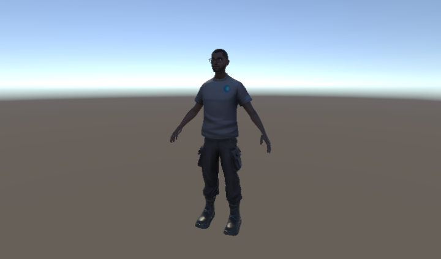
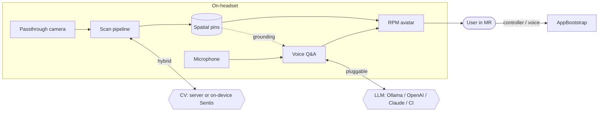
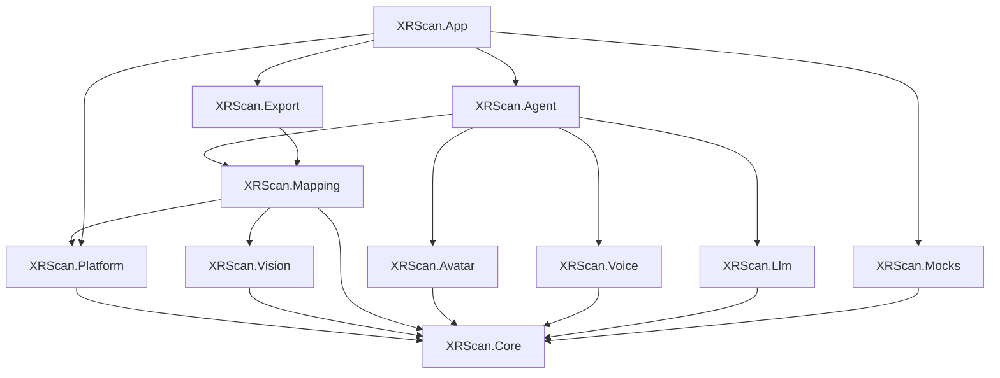
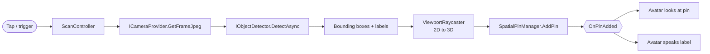
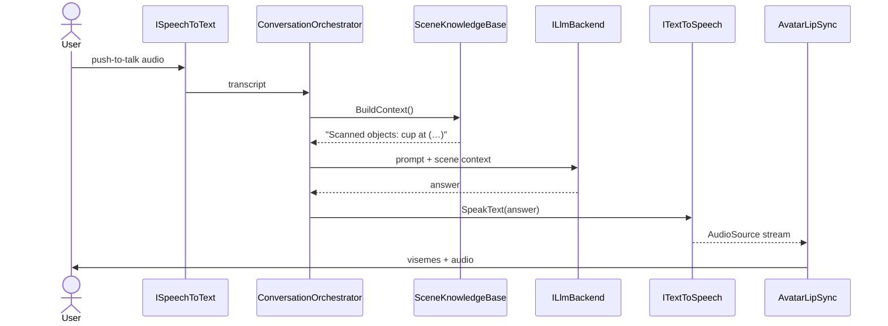
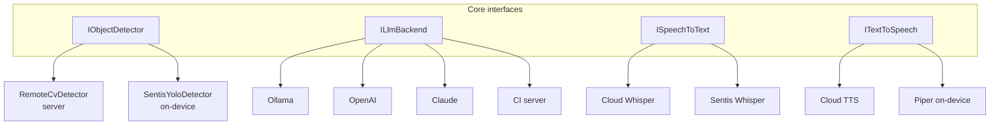
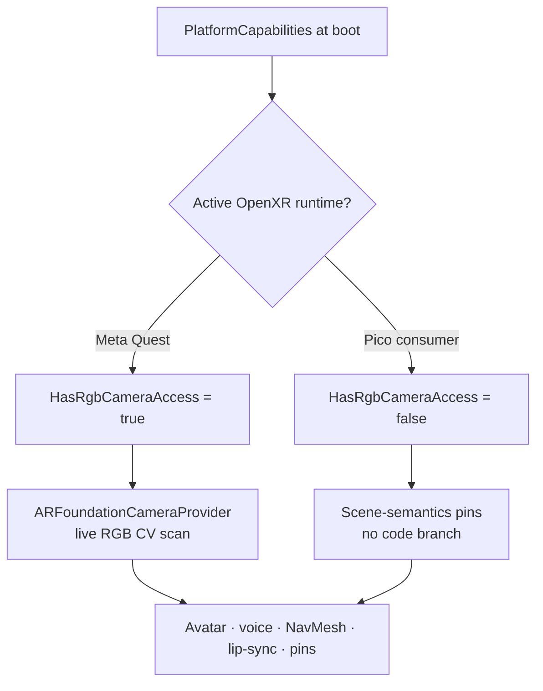
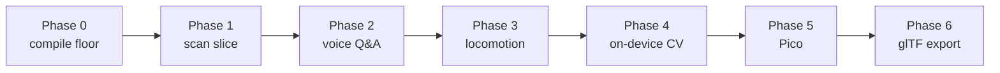

# CI Spatial Companion — Architecture

An embodied mixed-reality companion for **Meta Quest 3** and **Pico**, built on **Unity 6.3 LTS**, OpenXR-first. It scans the room (passthrough → object detection → world-anchored pins) and answers questions about it through a **Ready Player Me avatar** that looks, speaks with phoneme-accurate viseme lip-sync, and (WIP) walks the space.



---

## 1. System overview



The headset runs one OpenXR app; every external dependency (vision, LLM, speech) sits behind a swappable interface, so the same build works tethered to a server or fully on-device.

---

## 2. Module assemblies

Twelve assemblies with a strict dependency direction. `XRScan.Core` holds only interfaces + DTOs and references no vendor package — it is the **compile firewall**: a broken SDK can never stop the app logic from compiling.

| Assembly | Responsibility |
|---|---|
| `XRScan.Core` | Interfaces + DTOs (zero vendor deps) |
| `XRScan.Platform` | AR Foundation camera / scene / room-mesh providers; `PlatformCapabilities` |
| `XRScan.Vision` | CV server client + `RemoteCvDetector`; on-device `SentisYoloDetector` (scaffold) |
| `XRScan.Mapping` | `ViewportRaycaster`, `SpatialPinManager` (2D detection → 3D pins) |
| `XRScan.Avatar` | Load, gaze, gesture, uLipSync visemes, NavMesh locomotion |
| `XRScan.Voice` | STT / TTS (cloud + on-device Sentis / Piper scaffolds) |
| `XRScan.Llm` | Pluggable LLM backends |
| `XRScan.Agent` | `ConversationOrchestrator` + `SceneKnowledgeBase` |
| `XRScan.Export` | glTF export via glTFast + server sync |
| `XRScan.App` | `AppBootstrap` startup wiring + `ScanController` |
| `XRScan.Mocks` | Editor / test doubles (whole app runs with no device or server) |
| `XRScan.Tests.EditMode` | NUnit tests |



---

## 3. Scan pipeline

A single tap turns a camera frame into a world-anchored, labelled pin — and the avatar reacts.



`ViewportRaycaster` is tiered: AR Foundation raycast → environment-depth raycast (Meta, resolved *reflectively* so there is no compile-time vendor dependency) → physics → a fixed fallback distance.

---

## 4. Voice Q&A loop

Push-to-talk speech, grounded in what was actually scanned.



Because `SceneKnowledgeBase` injects the spatial pins into the prompt, "what do you see?" is answered from the real scanned world model, not hallucinated.

---

## 5. Pluggable intelligence (the "hybrid" seam)

Every intelligence stage is an interface. The concrete implementation is chosen from config at startup — no recompile. Secrets (endpoints, keys) load from `ServerConfig` / `LlmConfig` / `VoiceConfig` via PlayerPrefs / environment variables and are **never committed**.



`DetectorFactory` prefers the on-device detector when ready (untethered), else the CV server when a URL is configured, else a mock.

---

## 6. Cross-platform strategy (Quest 3 + Pico)

One OpenXR codebase, one APK, no per-vendor `#if` in app logic. Only the enabled OpenXR feature group differs per build. Capability differences are resolved at runtime by `PlatformCapabilities` and absorbed behind the provider interfaces.



**Why:** consumer Pico does not expose per-app RGB camera frames (enterprise-only), so live-camera scanning is Quest-first *by construction*; on Pico the pipeline degrades to scene-understanding pins automatically. Everything else runs at full parity.

---

## 7. Lip-sync

`AvatarLipSync` drives phoneme-accurate mouth shapes with **uLipSync**: the TTS `AudioSource` is analysed in real time and mapped onto the RPM / Oculus visemes present on the avatar's `Wolf3D_Head` + `Wolf3D_Teeth` meshes.

| uLipSync phoneme | RPM viseme |
|---|---|
| A | `viseme_aa` |
| I | `viseme_I` |
| U | `viseme_U` |
| E | `viseme_E` |
| O | `viseme_O` |
| S | `viseme_SS` |

RPM/Wolf3D avatars carry the full 15 Oculus visemes; the mapping is populated at runtime by resolving blendshape indices by name, so any RPM avatar works via `AvatarLoadController.avatarPrefab`.

---

## 8. Phase roadmap



| Phase | Scope | Status |
|---|---|---|
| 0 | OpenXR + toolchain compile floor | ✅ done |
| 1 | Scan → pin → avatar looks + speaks | ✅ done, verified in-Editor |
| 2 | Voice Q&A grounded in pins | ✅ done, verified in-Editor |
| 3 | NavMesh locomotion + gesture | ✅ code complete (device-verified next) |
| 4 | On-device Sentis YOLO / Piper | 🟡 scaffolded behind interfaces (needs models) |
| 5 | Pico bring-up | 🟡 package + capability gate in; device test pending |
| 6 | glTF export via glTFast | ✅ code complete |

---

## 9. Testing

`Assets/XRScan/Tests/EditMode` — 10 NUnit tests (bounding-box math, spatial-pin store dedup + events, detector contract). Run from **Window → General → Test Runner**, or headless:

```
Unity.exe -runTests -testPlatform EditMode -projectPath . -testResults results.xml -batchmode
```

The whole app also runs in-Editor on mocks (`AppBootstrap.useMocks = true`) — no device, server, or keys required — which is how Phases 1–2 are verified.
